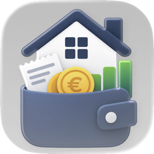

<p align="center">
  
</p>

<h1 align="center">Haushaltsbuch</h1>

<p align="center">
  Wie viel bleibt diesen Monat? Wofür ging das Geld raus? Wird es mehr oder weniger?<br>
  Ein Haushaltsbuch für den Mac.
</p>

---

Das Haushaltsbuch zeigt, was vom Monatsbudget übrig ist. Wiederkehrende Posten und Rücklagen fließen in die Übersicht ein. Es ist kein Finanzplaner, keine Buchhaltung und keine Vermögensverwaltung. Es hilft dabei, den Überblick über ein Monatsbudget zu behalten, und hört da auf.

*Die Oberfläche ist deutschsprachig.*

## Was es kann

- **Die große Zahl:** Einnahmen minus feste Ausgaben minus Rücklagen minus das, was diesen Monat schon ausgegeben wurde.
- **Feste Posten**, einmal angelegt, werden jeden Monat von selbst gebucht. Betragsänderungen gelten ab einem gewählten Monat.
- **Töpfe** für seltene Ausgaben wie Versicherungen, Urlaub oder Anschaffungen. Das Programm legt monatlich anteilig zurück.
- **Auswertung** über zwölf Monate, nach festen und variablen Ausgaben und nach Kategorien, mit Vergleich zum Vormonat.
- **Außerplanmäßige Ausgaben**, die den Kontostand senken, aber das Monatsbudget nicht treffen.
- **Kurzbefehle, Siri und Spotlight**: Ausgaben und Einnahmen erfassen, den Monatsstand abfragen. Buchungen vom iPhone kommen über einen Kurzbefehl und iCloud Drive.
- **Ganz mit der Tastatur** bedienbar.
- **Deine Daten bleiben deine:** Keine Anmeldung, kein Konto, keine Bankverbindung. Alles liegt in einer SQLite-Datei in deinem iCloud Drive, dazu monatliche Sicherungen auf dem Mac. Buchungen lassen sich als CSV ausgeben.

## Voraussetzungen

- macOS 26 oder neuer, Apple Silicon (M1 oder neuer)
- Zum Bauen: Xcode und [XcodeGen](https://github.com/yonaskolb/XcodeGen) (`brew install xcodegen`)

## Bauen

Die Xcode-Projektdatei wird aus `mac/project.yml` erzeugt und liegt nicht im Repository.

```sh
cd mac
xcodegen generate
open Haushaltsbuch.xcodeproj
```

**Signierung:** Damit macOS die Aktionen für Kurzbefehle und Spotlight anbietet, muss die App mit einem Entwicklerteam signiert sein. Ein kostenloses Personal Team reicht. Lege dafür `mac/Config/Signing.local.xcconfig` an (wird von Git ignoriert):

```
DEVELOPMENT_TEAM = DEINETEAMID
```

Ohne diese Datei baut und läuft das Programm trotzdem, nur ohne Kurzbefehle.

**Weitere Befehle** im Ordner `mac`:

| Befehl | Wirkung |
|---|---|
| `./bauen.sh` | Prüfungen ausführen und die fertige App samt Zip in `mac/dist` bauen |
| `./demo.sh` | eine Demodatenbank anlegen und das Programm damit öffnen; die echte Datenbank bleibt unberührt |
| `xcodebuild test -project Haushaltsbuch.xcodeproj -scheme Haushaltsbuch` | nur die Prüfungen |

## Wo die Daten liegen

| Was | Ort |
|---|---|
| Datenbank | iCloud Drive, Ordner `Haushaltsbuch`, Datei `haushaltsbuch.sqlite` |
| Sicherungen | `~/Library/Application Support/Haushaltsbuch/backup` |

## Aufbau

| Ordner | Inhalt |
|---|---|
| `mac/Haushaltsbuch` | das Programm (SwiftUI) |
| `mac/Haushaltsbuch/Kern` | Datenbank, Schema, Migrationen und Berechnungen |
| `mac/Kurzbefehle` | Aktionen für Kurzbefehle, Siri und Spotlight |
| `mac/HaushaltsbuchTests` | Prüfungen |
| `mac/Demodaten` | Werkzeug für die Demodatenbank |
| `mac/Bildprobe`, `mac/Tastentest` | kleine Entwicklungswerkzeuge |
| `web/assets/Anleitung Haushaltsbuch.pdf` | die Anleitung, die das Programm im Menü Hilfe zeigt |

## Lizenz

Das Haushaltsbuch steht unter der [MIT-Lizenz](../LICENSE).
